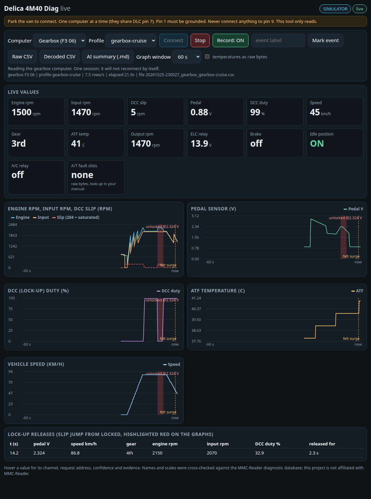
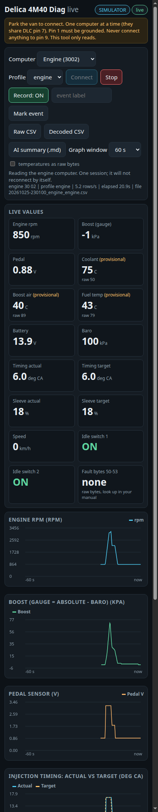

# delica-4m40-diag

**Read-only live data for the Mitsubishi Delica Space Gear 4M40 EFI (1997 to 2001 JDM diesel).**
Log the **gearbox** computer (diagnostic ID `F3 06`) and the **engine** computer (ID `3002`) with a $15 USB cable, watch
**live graphs** on a laptop or phone, decode logs to real units, and export a compact summary you can paste into an AI
chat.





*Screenshots of the built-in simulator (synthetic data), desktop gearbox view and phone engine view. Real-van screenshots welcome, see [CONTRIBUTING.md](CONTRIBUTING.md).*

> **Status (first release):** the protocol, channels and example logs come from a real van, recorded with the earlier
> prototype scripts. This packaged recorder and dashboard pass the full offline test suite and simulator, but have not
> yet been run against a van. Please report your first connection in an issue.

## What it does

- **Live dashboard** in your browser (`delica-live`): gauges, scrolling graphs, a computer selector, connect and stop, a record
  toggle with CSV download, an event-marker button, mobile layout, and automatic highlighting of **lock-up releases**.
- **Recorder** (`delica-log`): profiles `gearbox-cruise`, `gearbox-full`, `gearbox-flags`, `engine`; writes a wide CSV plus a
  JSONL event log.
- **Decoder** (`delica-decode`): raw CSV to engineering units (rpm, volts, km/h, deg C, percent, switch states).
- **AI export** (`delica-ai`): drive phases, events, trends and data-quality notes as Markdown and JSON, plus
  ready-made prompts in [docs/AI-ANALYSIS.md](docs/AI-ANALYSIS.md).
- **Simulator** of both computers, so you can try everything without a van (`--sim`).
- **Safety built in**: per-computer allowlists, no writes, no code clears, no actuator tests, no silent reconnects.
  See [docs/SAFETY.md](docs/SAFETY.md).

## Supported vehicles

Proven on: a **1999 Delica Space Gear 4M40 EFI (electronic injection pump), 4-speed electronic automatic**, 16-pin DLC. Same
family, likely to work but **unverified**: 1997 to 2001 Delica Space Gear (PD8W, PE8W, PF8W) with the 4M40 EFI diesel, and
related 4M40 EFI Pajeros. Other Mitsubishis (petrol, other years) use other IDs: do not assume. If your ID differs, the
program stops after the ID check; see "Reporting another ECU ID" in [CONTRIBUTING.md](CONTRIBUTING.md).

## What you need (about $15)

- A USB K-line cable sold as **VAG KKL 409.1** with an **FTDI FT232R** chip. Avoid CH340 clones, ELM327 and CAN-only adapters.
- A way to ground **DLC pin 1** (diagnosis mode): a jumper to pin 4 or a switch in a breakout box.
- **Never connect anything to pin 9** (the ETACS pulse line).

Details: [docs/HARDWARE.md](docs/HARDWARE.md).

## 5-minute quick start

Python 3.10 or newer.

```bash
git clone https://github.com/JadDid911/delica-4m40-diag.git
cd delica-4m40-diag
pip install .

# 1. Try it with no van: opens the dashboard on the simulator
delica-live --sim --open
```

In the page press **Connect**: a simulated gearbox drive runs for two minutes and loops; the lock-up release shows up at about
a minute in (red band, "unlocked @2.3 V"). Choose *Engine* to see the engine view.

With the van (parked, ignition on, **pin 1 grounded**, cable in the DLC, check-engine light blinking):

```bash
delica-live                       # then pick Gearbox or Engine and press Connect
# or record without the browser (600 s, gearbox cruise profile):
delica-log --ecu gearbox --seconds 600
delica-log --ecu engine  --seconds 300 --port COM5      # engine: needs a 10 s quiet line first

delica-decode logs/<file>.csv                  # engineering units
delica-ai     logs/<file>.csv                  # summary for ChatGPT / Claude
```

The same commands run as `python -m delica_mut live|log|decode|ai ...`. On a phone: `delica-live --lan` and open the printed
address (it contains a key) on the same Wi-Fi.

Try the AI export on the included sample drive (no hardware):

```bash
delica-ai examples/drive1_gearbox.csv --tz-offset -5 --stdout
```

It reports the lock-up release at 18:06:56 (pedal 2.31 V, about 87 km/h, 4th gear). The story behind it is in
[docs/FINDINGS-EXAMPLE.md](docs/FINDINGS-EXAMPLE.md).

## Safety summary

- Read-only: the gearbox allowlist is requests `00-BF` plus `FE`/`FF`; the engine allowlist is **only** the 31 documented
  reads, `FE`/`FF` and the one-shot ROM-ID reads `80/81/82`. The engine computer hides actuator tests inside `00-BF`
  (`B1 B2 BA BB BE BF`), so a generic sweep is unsafe there and is not offered.
- A lost session stops the run. It never reconnects silently (`--rewake N` is opt-in).
- One computer at a time (they share pin 7). Park for the wake-up. Never connect pin 9.
- Not a repair manual, no warranty. See [docs/SAFETY.md](docs/SAFETY.md).

## Documentation

| | |
| --- | --- |
| [docs/HARDWARE.md](docs/HARDWARE.md) | cable choice, breakout box, pin 1 options, pin 9 warning, driver notes |
| [docs/PROTOCOL.md](docs/PROTOCOL.md) | the wake-up recipes, timing, why address 00 failed for the gearbox, why the engine needs 10 s quiet |
| [docs/CHANNELS.md](docs/CHANNELS.md) | every channel with scale, confidence and evidence |
| [docs/SAFETY.md](docs/SAFETY.md) | what is enforced and how |
| [docs/AI-ANALYSIS.md](docs/AI-ANALYSIS.md) | summaries and prompt templates |
| [docs/FINDINGS-EXAMPLE.md](docs/FINDINGS-EXAMPLE.md) | case study: the lock-up schedule surge |
| [CONTRIBUTING.md](CONTRIBUTING.md) | reporting other ECU IDs and channel findings |

## Limits you should know

- Channel scales come from third-party documentation and were compared with one van. Confidence per channel is in
  [docs/CHANNELS.md](docs/CHANNELS.md). Nothing was calibrated against a meter, GPS or thermometer.
- The three engine **temperature** channels are *provisional*: a fitted curve, about +/-3 C. Supply your own table if you
  have one (see CHANNELS.md).
- Engine values under driving load (boost, timing, sleeve) have not been recorded yet; parked tests only.
- Polling is sequential: values within one cycle are not simultaneous (about 0.15 to 1.2 s apart depending on the profile).

## Credits and attribution

- **mitsu-kkl** by Alb7C4 (MIT): the vendored K-line transport (FTDI D2XX, break-based 5-baud wake-up). See
  `third_party/mitsu-kkl/`.
- Research and the validation of the channel map were done by the project owner with Codex and Claude assistance.
- Channel names and scales were cross-checked against the **MMC-Reader** diagnostic database. This project is **not affiliated
  with MMC-Reader**, and none of its database files, tables or fault texts are included. See `third_party/README.md`.
- Mitsubishi, Delica, Pajero and other names are trademarks of their owners. This project is **not affiliated with or
  endorsed by Mitsubishi Motors**, FTDI, or any tool vendor.

## Licence

MIT for this project's code and docs (see `LICENSE`). The vendored mitsu-kkl code keeps its own MIT licence.
